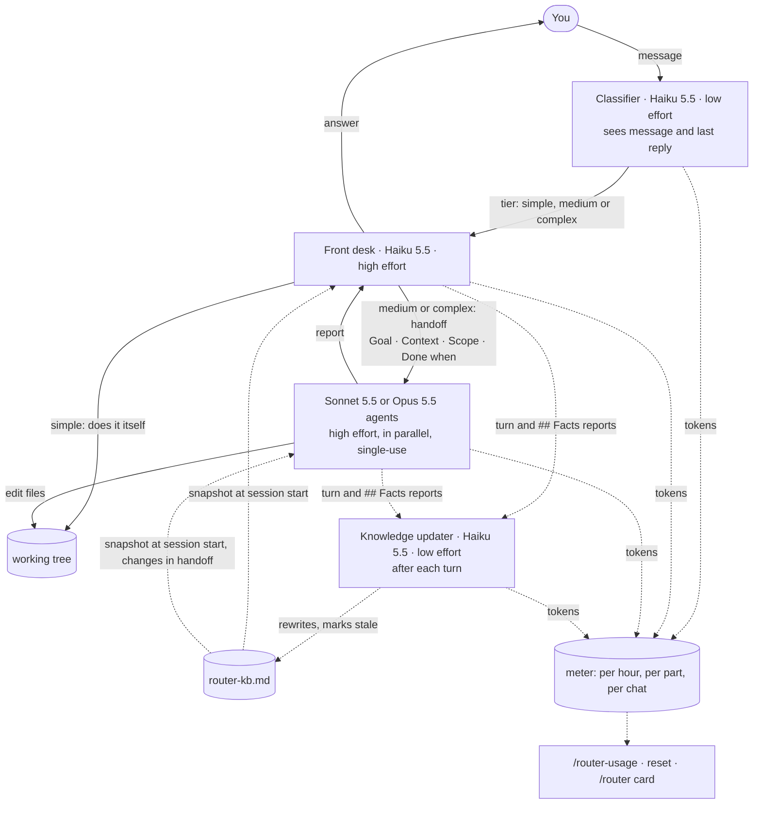

# Claude Router

**A cheap front desk that classifies every message and hands it to the smallest model that can do it well, inside Claude Code.**

You talk to Claude exactly as before. Behind the scenes, Claude Router picks who does the work for each message:

| Who | What it does | Think of it as |
|---|---|---|
| **Haiku** (the fastest, lightest model) | talks with you, and does the simple tasks itself: a named edit, a rename, a command, reading or explaining a file | the front desk |
| **A classifier** (Haiku, quick and light) | reads each message with the last reply and labels it simple, medium or complex | the triage nurse |
| **Sonnet** | takes medium tasks: an unclear bug, a feature across a few files, a review | the specialist |
| **Opus** (the most capable model) | takes complex tasks: architecture, big refactors, vague goals, security or performance analysis | the senior engineer |

## Why you'd want it

- **The cheapest model per message.** Simple requests never wake up the expensive models.
- **Routing is fixed, not improvised.** The rules are enforced by the plugin, so the main chat cannot quietly do the work of a bigger tier.
- **A shared knowledge base.** The router keeps notes about your project up to date, so the next model does not start from zero.
- **Plain, skimmable replies.** The front desk leads with the next action and writes numbered steps, in a style built for ADHD-friendly reading. Turn it off with `MODEL_ROUTER_STYLE=off`.
- **You can see where your usage goes.** One command shows how much of your Claude plan each part used.

## Before you start

You need:

- **Claude Code**, the terminal app or the VS Code extension, version 2.1.292 or newer. To check, run `claude --version` in a terminal.
- **A Claude plan that includes Opus 5.5, Sonnet 5.5 and Haiku 5.5.**
- **Git.** Most developer computers already have it; check with `git --version`.

## Install (about 2 minutes)

1. **Open a terminal.** On a Mac: the Terminal app. On Windows: PowerShell. In VS Code: menu **Terminal → New Terminal**.
2. **Copy this line, paste it and press Enter:**
   ```
   claude plugin install model-router --marketplace AndreaScotti01/claude_router --scope user
   ```
3. **Start a new Claude Code chat** (in VS Code: open a new Claude Code tab). Chats that were already open don't pick it up.

That's it.

## Check it's working

1. In a new chat, type `/router` and press Enter. You should see a card that starts with **● model-router active** and lists which model does what: the front desk, the medium and complex agents, and the classifier.
2. Ask for a small, named change, such as renaming a function. Haiku does it directly. Then ask for something open-ended, such as "why does the export sometimes drop rows?". You'll see a `Sonnet 5.5 · …` or `Opus 5.5 · …` agent row, and the front desk tells you what the agent found.

## See where your usage goes: `/router-usage`

Type `/router-usage` in any chat. You get three tables:

1. **Account plan**: how much of your Claude allowance is used right now, across all your devices.
   - *session (5h)*: the allowance that refills every 5 hours
   - *week (7d)*: the weekly allowance
2. **This chat**: what the router used in the chat you're typing in.
3. **All chats on this computer**: the running total for every chat on this computer, open or closed.

In tables 2 and 3, each row is one part of the router:

| Row | What it counts |
|---|---|
| **Front desk (simple)** | Haiku answering you and doing simple tasks |
| **↳ routing** | the classifier's call on each message |
| **↳ handoff docs (est.)** | the handoff documents the front desk writes for agents, estimated from their length |
| **↳ knowledge base** | the updater's Haiku calls that keep the shared notes file up to date |
| **Medium agents** | Sonnet agents |
| **Complex agents** | Opus agents |
| **other subagents** | any other subagent |

Older history may also show **executors (old)** and **reviews (old)** from the previous version.

Every part has these columns:

| Column | What it means |
|---|---|
| **share** | this part's share of the work, weighted by how expensive its model is |
| **≈ of session / ≈ of week** | roughly how many points of your allowance it cost. It says "calibrating" until the router has watched your allowance move a few points, usually within an hour of normal use |
| **in / out** | text the model read / wrote, counted in tokens (a token is roughly ¾ of a word) |
| **cache read / cache write** | earlier conversation the model re-read from its short-term memory (cheap) / saved there for next time |
| **cache hit** | the share of input read from the prompt cache, see [How caching works](#how-caching-works) |

To start counting from zero, type `/router-usage reset`. Your allowance is not affected: that figure is Anthropic's.

## The shared notes file

The router keeps short notes about your project in `.claude/router-kb.md`, inside the project folder. After every reply, a small, cheap model reads the exchange and updates the notes with anything durable: what a file does, a convention, a decision and why, a gotcha. Models do not edit the file themselves. Notes about files that changed since the file was last checked are marked `(stale?)`, so models check them before relying on them. The file stays under 8000 characters: when it grows past that, the least useful notes are merged or dropped.

You can read and edit the file like any other. Commit it so your team shares the notes, or add it to `.gitignore` to keep it on your computer.

## Update

```
claude plugin update model-router@claude-router
```

Then start a new chat.

## Uninstall

```
claude plugin uninstall model-router@claude-router --scope user
claude plugin marketplace remove claude-router
```

## Common questions

**Do I need to change how I talk to Claude?**
No. Ask as usual; the routing happens on its own.

**Why did Claude hand my request to another model?**
That's the router picking the tier for your message. Simple requests stay with Haiku. Medium ones go to Sonnet agents and complex ones to Opus agents. When the classifier is unsure, it picks the higher tier; if it fails, the message goes to medium. If you want a specific tier, start your message with `!haiku`, `!sonnet` or `!opus` and the classifier is skipped.

**Does it work in VS Code?**
Yes. The `/plugin` menu only exists in the terminal app, but the install command above works from VS Code's built-in terminal, and everything else works in both.

**Why don't the router's numbers add up to my plan usage?**
Your plan figure counts everything on your account: other computers, claude.ai, and chats without the router. The router's tables count only this computer's chats that have the router turned on.

**Something looks stuck or wrong?**
Type `/reload-plugins`, or start a new chat.

---

## Under the hood

For readers who want to know exactly what the plugin does. It is a Claude Code plugin made of function hooks (`hooks/register.tsx`) that classify each message, rewrite or refuse model requests and tool calls as they happen, and keep the shared knowledge base.

### Roles and how each is enforced

| Role | Model | Enforced by |
|---|---|---|
| Front desk | Haiku 5.5, high effort | every main-chat model request is rewritten to the simple model and effort; a system-prompt section teaches the protocol, carries a snapshot of the knowledge base taken at session start, and sets the ADHD-friendly output style (next action first, numbered steps, at most 5 items per list, one concrete next action at the end); agent reports come in a shape the front desk can relay without pasting them whole |
| Classifier | Haiku 5.5, low effort | one hardcoded call per user message, seeing the message and the last assistant reply; it answers simple, medium or complex. Unsure means the higher tier; a failed call means medium; a leading `!haiku`, `!sonnet` or `!opus` skips the call and forces the tier |
| Knowledge updater | Haiku 5.5, low effort | one call after each main-chat turn, in the background; sees the knowledge base and that turn (your message, the final answer, the agents' reports) and returns the updated list or NONE |
| Simple | Haiku 5.5, high effort | the front desk does the work itself |
| Medium | Sonnet 5.5, high effort | the main chat may only spawn fresh `model-router:sonnet` agents; every other tool call is refused for that message |
| Complex | Opus 5.5, high effort | the main chat may only spawn `model-router:opus` agents; every other tool call is refused for that message |
| Parallel work | per tier | several agents run at once for independent pieces; agents edit files themselves |
| Handoff | — | each agent prompt must have the headings `## Goal`, `## Context`, `## Scope`, `## Done when`, in that order, or it is refused; the router appends the user's message verbatim, puts the knowledge base in the agent's system prompt, and the agent ends its report with a `## Facts` section |
| Knowledge base | all | `.claude/router-kb.md`, read by the front desk and each agent at session start (the agents also get the current version in their handoff when it changed), written only by the knowledge updater |
| Single-use agents | Sonnet 5.5, Opus 5.5 | fresh sessions: SendMessage to them is refused and they are never compacted |

Effort is set on every request: by default the front desk, Sonnet and Opus run at high, and the classifier and the updater at low (see [Configure](#configure) to change it). Your session's effort setting does not change it. The output style is adapted from [i-have-adhd](https://github.com/ayghri/i-have-adhd) (MIT).

### Flow



### The handoff document

Every agent starts with no memory of the conversation, so the front desk must write it a handoff with four headings, in this order:

- `## Goal`: what the result should be and why
- `## Context`: everything the agent needs to know (paths, URLs, conventions, the user's intent)
- `## Scope`: which files or areas it may touch, and what is out of scope
- `## Done when`: how the agent knows it is finished

Headings count only at the start of a line, so a handoff can mention them in its text.

### Shared knowledge base

- **Where it lives.** `.claude/router-kb.md` in the project folder. Its first line is `<!-- model-router knowledge base · checked at <git commit> -->`. Below it, one fact per bullet, `- (relative/path) fact`, kept under `MODEL_ROUTER_KB_CHARS` (8000 by default).
- **Who reads it.** The front desk gets a snapshot in its system prompt at session start. Each Sonnet or Opus agent gets a snapshot in its system prompt at session start. If the file changed since then, the current version is also appended to the agent's handoff under "Knowledge base updates".
- **Who writes it.** Only the knowledge updater. After every main-chat turn, a Haiku 5.5 call (low effort, in the background) reads the file plus that turn: your message, the final answer, and the agents' reports, which end with a `## Facts` section. It returns the updated list or `NONE`. Its rules:
  - one fact per bullet, and only durable ones: what files do, conventions, decisions and why, gotchas, working commands. Never task status;
  - keep existing bullets unless a turn contradicts or duplicates them;
  - over the limit, merge and drop the least useful bullets instead of cutting off the end;
  - a rewrite that would drop more than half the facts is refused.
- **Stale facts.** At session start the router asks git which files changed since the commit in the header, committed or not, and marks their bullets `(stale?)`. Models check the file before relying on a marked bullet. The updater removes the mark only when a turn confirms the fact, and fixes or drops it when a turn contradicts it. Uncommitted changes re-mark their bullets every session until they are committed. Without git, nothing is marked.
- **Your control.** It is a plain file: edit it by hand, commit it, or git-ignore it.

### How caching works

The prompt cache stores the start of a prompt, so a later request that begins with the same bytes reads it back for about 5–10% of the normal input price. The rules that matter here:

- **It is a prefix match.** A byte changed early in the prompt invalidates everything after it.
- **It is per model.** Haiku, Sonnet and Opus never share entries.
- **It is shared across sessions in the same workspace**, never across organizations.
- **Entries live 5 minutes or 1 hour**, chosen by Claude Code. Every read resets the timer.
- **Prompts under 512 tokens are never cached** on the 5.5 models.

What the router does to protect the cache:

- The front desk stays on one model for the whole session.
- The protocol and the knowledge-base snapshot are frozen at session start.
- Each Sonnet or Opus agent gets the knowledge base as a session-start snapshot in its system prompt, so every spawn of the same model reads it from the cache; facts added since then ride along in the handoff.
- The per-message tier note goes after the user message, not in the system prompt.
- Effort is fixed per role.

What it can't change: Claude Code's own session-specific prompt (date, git status, CLAUDE.md) is rewritten once per new session. In tests, about 25k tokens were reused across sessions and 17–19k were rewritten.

To check it, read the `cache hit` column in `/router-usage`, or run the prompt-cache query in [Analytics](#analytics).

### Usage metering

- **Where it's stored.** Router usage is kept per hour, per part and per chat in one file, `~/.claude/model-router-usage.json`, shared by every chat on this computer and by every copy of the plugin, for 35 days.
- **Scope.** It counts only sessions on this computer with the router loaded. The plan % is Anthropic's account-wide reading (all devices, claude.ai, sessions without the router), so the two are shown apart.
- **Shares.** Each part's share weighs its calls by API list price (cache writes weigh more than output, cache reads little); no money amounts are shown.
- **Plan points.** The router learns how many plan points one unit of usage costs each time the plan moves 5+ points while this computer is working. It keeps the lowest rate seen, so usage on other devices is left out, and shows "calibrating" until the first sample. `/router-usage reset` clears the counters but keeps this calibration.
- **Handoff tokens** are estimated from document length (4 characters ≈ 1 token) and appear as the `↳ handoff docs (est.)` part.

### Analytics

A raw per-event log, to tune the router for cost (which tier and model spend what, how often the classifier picks each tier, how often agents are refused, which refusals fire). The JSON usage file stays what `/router-usage` reads.

It is written with the `sqlite3` command-line tool (preinstalled on macOS and most Linux; without it nothing is recorded). Table `events`, one row per event:

| Column | What it holds |
|---|---|
| `ts` | time, ISO 8601 UTC |
| `session` | chat id |
| `kind` | `prompt`, `route`, `request`, `tool`, `agent` or `kb` |
| `part` | the meter part the row counts toward, where it applies |
| `model`, `effort`, `agent` | model, effort, and agent id where they apply |
| `input`, `output`, `cache_read`, `cache_write` | tokens |
| `cost` | API list-price $ |
| `detail` | JSON, see below |

What `detail` holds per `kind`:

- `prompt`: `settings` (every `MODEL_ROUTER_*` value in force)
- `route`: `tier` (the classifier's pick) and `forced` (whether a `!` prefix chose it)
- `request`: one model request (part, tokens, cost)
- `tool`: every tool call (`tool`, `path`, `subagentType`, `deny` = the router's refusal, if any)
- `agent`: an agent finished (`tier`, `task`, `handoffChars`, `isError`, `deny`)
- `kb`: the knowledge base was rewritten (its size in characters before and after)

Example queries:

```sql
-- API $ per part and model, per day
SELECT date(ts) AS day, part, model, round(sum(cost), 2) AS usd, sum(input + output) AS tokens FROM events WHERE kind = 'request' GROUP BY 1, 2, 3 ORDER BY 1 DESC, 4 DESC;
-- How often each router refusal fires
SELECT json_extract(detail, '$.deny') AS deny, count(*) FROM events WHERE kind = 'tool' AND deny IS NOT NULL GROUP BY 1 ORDER BY 2 DESC;
-- Tier counts per day
SELECT date(ts) AS day, json_extract(detail, '$.tier') AS tier, count(*) FROM events WHERE kind = 'route' GROUP BY 1, 2 ORDER BY 1 DESC;
-- Prompt-cache hit rate per part and model
SELECT part, model, round(100.0 * sum(cache_read) / nullif(sum(input + cache_read + cache_write), 0), 1) AS cache_hit_pct FROM events WHERE kind = 'request' GROUP BY 1, 2 ORDER BY 3;
```

Open it with `sqlite3 ~/.claude/model-router-analytics.db`.

### What you'll see, in detail

| Check | Terminal | VS Code |
|---|---|---|
| Run `claude plugin list` | shows `model-router@claude-router`, `Status: ✔ enabled` | same (VS Code terminal) |
| Type `/router` | status card (front desk, medium, complex and classifier models with efforts, last route, running agents) and reopens the pane | status card |
| Type `/router-usage` | the three tables described above | same |
| Ask for a small change | Haiku does it, no agent row | same |
| Ask for something open-ended | agent rows labelled `Sonnet 5.5 · <task>` or `Opus 5.5 · <task>`; the front desk relays the report | same |
| Status line `router · today haiku 40k · sonnet 11k · opus 6k` | under the prompt | where the extension shows plugin status lines |
| **Model router** pane: `● model-router active`, models per role with efforts, last route, running agents | opens at session start (wide terminals) or with your first prompt | opens with your first prompt |

### Other ways to install

`/plugin` is interactive and exists only in a terminal session; in the VS Code extension it answers `/plugin isn't available in this environment`. In a terminal session the interactive equivalent of the install command is `/plugin install model-router --marketplace AndreaScotti01/claude_router` (answer `y` to **Add marketplace?**, then pick the **user** scope).

**From a local clone (no push needed):**

```
git clone https://github.com/AndreaScotti01/claude_router.git ~/PycharmProjects/claude_router
claude plugin marketplace add ~/PycharmProjects/claude_router
claude plugin install model-router@claude-router --scope user
```

The plugin is then read from the folder itself (`claude plugin list` shows `Read from: <folder>`): edit it and run `/reload-plugins`, no reinstall. To update, `git pull` in the folder, then `/reload-plugins` in open sessions.

**Load it without installing (one session):**

```
claude --plugin-dir ~/PycharmProjects/claude_router
```

Where no flag can be given (VS Code, SDK hosts), name the folder in `~/.claude/settings.json` and open a new session:

```json
{ "env": { "CLAUDE_CODE_PLUGIN_DIRS": "/absolute/path/to/claude_router" } }
```

Do not combine an install with `--plugin-dir` or `CLAUDE_CODE_PLUGIN_DIRS` on the same folder: the plugin would load twice (double metering, double hooks).

### Configure

The router reads these environment variables when a session starts and on every prompt.

| Variable | Default | What it sets |
|---|---|---|
| `MODEL_ROUTER_SIMPLE_MODEL` | `claude-haiku-5-5` | front desk and simple tasks |
| `MODEL_ROUTER_SIMPLE_EFFORT` | `high` | effort of the front desk and simple tasks |
| `MODEL_ROUTER_MEDIUM_MODEL` | `claude-sonnet-5-5` | agents for medium tasks |
| `MODEL_ROUTER_MEDIUM_EFFORT` | `high` | effort of the medium agents |
| `MODEL_ROUTER_COMPLEX_MODEL` | `claude-opus-5-5` | agents for complex tasks |
| `MODEL_ROUTER_COMPLEX_EFFORT` | `high` | effort of the complex agents |
| `MODEL_ROUTER_CLASSIFIER_MODEL` | `claude-haiku-5-5` | model that picks the tier |
| `MODEL_ROUTER_CLASSIFIER_EFFORT` | `low` | effort of the classifier |
| `MODEL_ROUTER_KB_CHARS` | `8000` | characters of the knowledge base sent to models; also the size the updater keeps the file under |
| `MODEL_ROUTER_STYLE` | `adhd` | how the front desk writes to you; `off` for Claude's default style |
| `MODEL_ROUTER_ANALYTICS_DB` | `~/.claude/model-router-analytics.db` | SQLite file every router event is appended to; `off` disables it |

An effort must be `low`, `medium`, `high`, `xhigh` or `max`, and a number must be a positive integer. Any other value falls back to the default.

Set them in the `"env"` object of `~/.claude/settings.json` or the project's `.claude/settings.json`, or export them in the shell before you start `claude`:

```json
{ "env": { "MODEL_ROUTER_COMPLEX_EFFORT": "medium", "MODEL_ROUTER_KB_CHARS": "4000" } }
```

A change applies after `/reload-plugins` or in a new session.

### Known limits

- Agents are single-use and not compacted: an agent that fills its context ends, and the front desk re-delegates a smaller task.
- Agent bookkeeping lives in memory: a hot reload while an agent runs loses track of it; ask again.
- Finished agents stay listed in VS Code's Agent map until Claude Code drops them; the plugin API cannot remove them (they can no longer be resumed).
- The plugin API is early access; a Claude Code update can break it.
- In one-shot `claude -p` runs the knowledge-base update must finish within about 1.5 seconds after the answer (Claude Code's limit on the session-end hook); a larger update can be lost. Interactive chats are not affected.

### Develop

```
claude plugin validate .
claude plugin test .
claude --plugin-dir .
tsc -p .   # after the plugin has loaded once (the engine lays .claude-plugin/types/)
```
