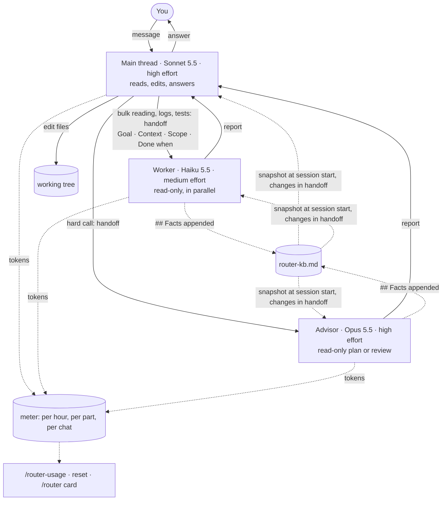

# Claude Router

**One steady main model that does the work, a cheap worker for bulk reading, and a read-only Opus for hard calls, inside Claude Code.**

You talk to Claude exactly as before. Behind the scenes, Claude Router keeps three roles apart:

| Who | What it does | Think of it as |
|---|---|---|
| **Sonnet** (the main thread) | talks with you, reads the code and makes every edit itself | the engineer |
| **Haiku** (the fastest, lightest model) | reads or searches many files, summarises long logs, runs tests and builds, and reports back. It cannot edit | the assistant |
| **Opus** (the most capable model) | gives a plan or a review on hard calls: a change across more than 5 files, a costly design, security or performance decision, a fix that failed twice. It is read-only, so Sonnet makes the edits | the senior advisor |

## Why you'd want it

- **One model holds the conversation.** The main thread never changes model, so its prompt cache stays warm, and the model that understands your request is the one that edits.
- **Delegate down, not sideways.** Bulk, checkable work goes to the cheapest model; hard decisions get a second opinion from the most capable one. Nothing is classified or locked out: the main thread keeps all its tools.
- **A shared knowledge base.** The facts agents learn about your project are kept, so the next model does not start from zero.
- **Plain, skimmable replies.** The main thread leads with the next action and writes numbered steps, in a style built for ADHD-friendly reading. Turn it off with `MODEL_ROUTER_STYLE=off`.
- **You can see where your usage goes.** One command shows how much of your Claude plan each part used.

## Before you start

You need:

- **Claude Code**, the terminal app or the VS Code extension, version 2.1.292 or newer. To check, run `claude --version` in a terminal.
- **A Claude plan that includes Opus 5.5, Sonnet 5.5 and Haiku 5.5.**
- **Git.** Most developer computers already have it; check with `git --version`.

## Install (about 2 minutes)

1. **Open a terminal.** On a Mac: the Terminal app. On Windows: PowerShell. In VS Code: menu **Terminal → New Terminal**.
2. **Copy this line, paste it and press Enter:**
   ```
   claude plugin install model-router --marketplace AndreaScotti01/claude_router --scope user
   ```
3. **Start a new Claude Code chat** (in VS Code: open a new Claude Code tab). Chats that were already open don't pick it up.

That's it.

## Check it's working

1. In a new chat, type `/router` and press Enter. You should see a card that starts with **● model-router active** and lists which model does what: the main thread, the worker and the advisor.
2. Ask for a small, named change, such as renaming a function. Sonnet does it directly. Then ask for something that needs a lot of reading, such as "find every place the export drops rows and run the tests". You'll see a `Haiku 5.5 · …` agent row, and Sonnet tells you what the agent found.

## See where your usage goes: `/router-usage`

Type `/router-usage` in any chat. You get three tables:

1. **Account plan**: how much of your Claude allowance is used right now, across all your devices.
   - *session (5h)*: the allowance that refills every 5 hours
   - *week (7d)*: the weekly allowance
2. **This chat**: what the router used in the chat you're typing in.
3. **All chats on this computer**: the running total for every chat on this computer, open or closed.

In tables 2 and 3, each row is one part of the router:

| Row | What it counts |
|---|---|
| **Main thread** | Sonnet answering you and making the edits |
| **↳ handoff docs (est.)** | the handoff documents the main thread writes for agents, estimated from their length |
| **Worker agents** | Haiku agents |
| **Advisor agents** | Opus agents |
| **other subagents** | any other subagent |

Older history may also show **routing (old)**, **knowledge base (old)**, **Medium agents (old)**, **Complex agents (old)**, **executors (old)** and **reviews (old)** from the previous versions.

Every part has these columns:

| Column | What it means |
|---|---|
| **share** | this part's share of the work, weighted by how expensive its model is |
| **≈ of session / ≈ of week** | roughly how many points of your allowance it cost. It says "calibrating" until the router has watched your allowance move a few points, usually within an hour of normal use |
| **in / out** | text the model read / wrote, counted in tokens (a token is roughly ¾ of a word) |
| **cache read / cache write** | earlier conversation the model re-read from its short-term memory (cheap) / saved there for next time |
| **cache hit** | the share of input read from the prompt cache, see [How caching works](#how-caching-works) |

To start counting from zero, type `/router-usage reset`. Your allowance is not affected: that figure is Anthropic's.

## The shared notes file

The router keeps short notes about your project in `.claude/router-kb.md`, inside the project folder. Every worker or advisor report ends with a `## Facts` section; the router appends those bullets to the file as written (no model rewrites it). A fact already in the file is confirmed instead of duplicated. Notes about files that changed since the file was last checked are marked `(stale?)`, so models check them before relying on them; a fact an agent reports again loses its mark. The file stays under 8000 characters: when it grows past that, the oldest notes are dropped first.

You can read and edit the file like any other. Commit it so your team shares the notes, or add it to `.gitignore` to keep it on your computer.

## Update

```
claude plugin update model-router@claude-router
```

Then start a new chat.

## Uninstall

```
claude plugin uninstall model-router@claude-router --scope user
claude plugin marketplace remove claude-router
```

## Common questions

**Do I need to change how I talk to Claude?**
No. Ask as usual; the routing happens on its own.

**Why did Claude hand part of my request to another model?**
The main thread (Sonnet) delegates bulk reading, log summaries and test runs to Haiku, and asks Opus for a plan or review on hard calls. It decides this itself from the rules in its system prompt; nothing classifies your message first and nothing is locked. If you want a specific model, just say so ("ask the Opus advisor to review this plan").

**Does it work in VS Code?**
Yes. The `/plugin` menu only exists in the terminal app, but the install command above works from VS Code's built-in terminal, and everything else works in both.

**Why don't the router's numbers add up to my plan usage?**
Your plan figure counts everything on your account: other computers, claude.ai, and chats without the router. The router's tables count only this computer's chats that have the router turned on.

**Something looks stuck or wrong?**
Type `/reload-plugins`, or start a new chat.

---

## Under the hood

For readers who want to know exactly what the plugin does. It is a Claude Code plugin made of function hooks (`hooks/register.tsx`) that rewrite model requests, check agent handoffs, keep the shared knowledge base and meter usage.

### Roles and how each is enforced

| Role | Model | Enforced by |
|---|---|---|
| Main thread | Sonnet 5.5, high effort | every main-chat model request is rewritten to this model and effort; a system-prompt section teaches the protocol, carries a snapshot of the knowledge base taken at session start, and sets the ADHD-friendly output style |
| Worker | Haiku 5.5, medium effort | registered as `model-router:haiku`; read-only (no Edit, Write or Agent); for bulk reading, searching, summarising and test runs |
| Advisor | Opus 5.5, high effort | registered as `model-router:opus`; read-only; returns a plan or review for a change across more than 5 files, a costly design, security or performance call, or a fix that failed twice. The triggers are in the main thread's prompt, not enforced by code |
| Parallel work | per role | several workers run at once for independent pieces |
| Handoff | — | each agent prompt must have the headings `## Goal`, `## Context`, `## Scope`, `## Done when`, or it is refused; the router appends the user's message verbatim, puts the knowledge base in the agent's system prompt, and the agent ends its report with a `## Facts` section |
| Knowledge base | all | `.claude/router-kb.md`, read by the main thread and each agent at session start (the agents also get the current version in their handoff when it changed), appended to only by the router, from agents' `## Facts` |
| Resuming | — | a finished agent can be resumed with SendMessage for `MODEL_ROUTER_RESUME_MINUTES` (55 by default, `0` turns it off); after that SendMessage is refused and the main thread spawns a fresh agent |

Effort is set on every request: by default the main thread and the advisor run at high and the worker at medium (see [Configure](#configure) to change it). Your session's effort setting does not change it. The output style is adapted from [i-have-adhd](https://github.com/ayghri/i-have-adhd) (MIT).

### Flow



### The handoff document

Every agent starts with no memory of the conversation, so the main thread must write it a handoff with four headings, in this order:

- `## Goal`: what the result should be and why
- `## Context`: everything the agent needs to know (paths, URLs, conventions, the user's intent)
- `## Scope`: which files or areas it may touch, and what is out of scope
- `## Done when`: how the agent knows it is finished

Resuming a finished agent with SendMessage needs no new handoff: the agent keeps its context.

### Shared knowledge base

- **Where it lives.** `.claude/router-kb.md` in the project folder. Its first line is `<!-- model-router knowledge base · checked at <git commit> -->`. Below it, one fact per bullet, `- (relative/path) fact`, kept under `MODEL_ROUTER_KB_CHARS` (8000 by default).
- **Who reads it.** The main thread gets a snapshot in its system prompt at session start. Each worker or advisor agent gets a snapshot in its system prompt at session start. If the file changed since then, the current version is also appended to the agent's handoff under "Knowledge base updates".
- **Who writes it.** Only the router, and without a model: when a worker or advisor reports, the bullets of its `## Facts` section (one fact per line, `- (relative/path) fact`; `none` adds nothing) are appended. The agent saw the code, so its facts are first-hand. Over the limit, the oldest bullets are dropped first.
- **Stale facts.** At session start the router asks git which files changed since the commit in the header, committed or not, and marks their bullets `(stale?)`. Models check the file before relying on a marked bullet. A fact an agent reports again word for word loses its mark. A fact that changed is added as a new bullet; edit the file to remove the outdated one. Uncommitted changes re-mark their bullets every session until they are committed. Without git, nothing is marked.
- **Your control.** It is a plain file: edit it by hand, commit it, or git-ignore it.

### How caching works

The prompt cache stores the start of a prompt, so a later request that begins with the same bytes reads it back for about 5–10% of the normal input price. The rules that matter here:

- **It is a prefix match.** A byte changed early in the prompt invalidates everything after it.
- **It is per model.** Haiku, Sonnet and Opus never share entries.
- **It is shared across sessions in the same workspace**, never across organizations.
- **Entries live 5 minutes or 1 hour**, chosen by Claude Code. Every read resets the timer.
- **Prompts under 512 tokens are never cached** on the 5.5 models.

What the router does to protect the cache:

- The main thread stays on one model for the whole session, and nothing routes a message to another model mid-conversation.
- The protocol and the knowledge-base snapshot are frozen at session start.
- Each worker or advisor gets the knowledge base as a session-start snapshot in its system prompt, so every spawn of the same model reads it from the cache; facts added since then ride along in the handoff.
- A finished agent is resumed, not respawned, while its cache is still warm (`MODEL_ROUTER_RESUME_MINUTES`).
- Effort is fixed per role.

What it can't change: Claude Code's own session-specific prompt (date, git status, CLAUDE.md) is rewritten once per new session. A high `cache hit` is normal for any Claude Code session (an agent re-reads its own history on every step), so it does not show that routing saves money. To judge that, compare cost per finished task against the same tasks on one model; the analytics database has the router side.

To check it, read the `cache hit` column in `/router-usage`, or run the prompt-cache query in [Analytics](#analytics).

### Usage metering

- **Where it's stored.** Router usage is kept per hour, per part and per chat in one file, `~/.claude/model-router-usage.json`, shared by every chat on this computer and by every copy of the plugin, for 35 days.
- **Scope.** It counts only sessions on this computer with the router loaded. The plan % is Anthropic's account-wide reading (all devices, claude.ai, sessions without the router), so the two are shown apart.
- **Shares.** Each part's share weighs its calls by API list price (cache writes weigh more than output, cache reads little); no money amounts are shown.
- **Plan points.** The router learns how many plan points one unit of usage costs each time the plan moves 5+ points while this computer is working. It keeps the lowest rate seen, so usage on other devices is left out, and shows "calibrating" until the first sample. `/router-usage reset` clears the counters but keeps this calibration.
- **Handoff tokens** are estimated from document length (4 characters ≈ 1 token) and appear as the `↳ handoff docs (est.)` part.

### Analytics

A raw per-event log, to tune the router for cost (which role and model spend what, how often agents are refused, which refusals fire). The JSON usage file stays what `/router-usage` reads.

It is written with the `sqlite3` command-line tool (preinstalled on macOS and most Linux; without it nothing is recorded). Table `events`, one row per event:

| Column | What it holds |
|---|---|
| `ts` | time, ISO 8601 UTC |
| `session` | chat id |
| `kind` | `prompt`, `request`, `tool`, `agent` or `kb` |
| `part` | the meter part the row counts toward, where it applies |
| `model`, `effort`, `agent` | model, effort, and agent id where they apply |
| `input`, `output`, `cache_read`, `cache_write` | tokens |
| `cost` | API list-price $ |
| `detail` | JSON, see below |

What `detail` holds per `kind`:

- `prompt`: `settings` (every `MODEL_ROUTER_*` value in force)
- `request`: one model request (part, tokens, cost)
- `tool`: every tool call (`tool`, `path`, `subagentType`, `deny` = the router's refusal, if any)
- `agent`: an agent finished (`role`, `task`, `handoffChars`, `isError`, `deny`)
- `kb`: facts were appended to the knowledge base (its size in characters before and after)

Example queries:

```sql
-- API $ per part and model, per day
SELECT date(ts) AS day, part, model, round(sum(cost), 2) AS usd, sum(input + output) AS tokens FROM events WHERE kind = 'request' GROUP BY 1, 2, 3 ORDER BY 1 DESC, 4 DESC;
-- How often each router refusal fires
SELECT json_extract(detail, '$.deny') AS deny, count(*) FROM events WHERE kind = 'tool' AND deny IS NOT NULL GROUP BY 1 ORDER BY 2 DESC;
-- Agent runs per role per day
SELECT date(ts) AS day, json_extract(detail, '$.role') AS role, count(*) FROM events WHERE kind = 'agent' GROUP BY 1, 2 ORDER BY 1 DESC;
-- Prompt-cache hit rate per part and model
SELECT part, model, round(100.0 * sum(cache_read) / nullif(sum(input + cache_read + cache_write), 0), 1) AS cache_hit_pct FROM events WHERE kind = 'request' GROUP BY 1, 2 ORDER BY 3;
```

Open it with `sqlite3 ~/.claude/model-router-analytics.db`.

### What you'll see, in detail

| Check | Terminal | VS Code |
|---|---|---|
| Run `claude plugin list` | shows `model-router@claude-router`, `Status: ✔ enabled` | same (VS Code terminal) |
| Type `/router` | status card (main thread, worker and advisor models with efforts, running agents) and reopens the pane | status card |
| Type `/router-usage` | the three tables described above | same |
| Ask for a small change | Sonnet does it, no agent row | same |
| Ask for bulk reading or a hard call | agent rows labelled `Haiku 5.5 · <task>` or `Opus 5.5 · <task>`; the main thread relays the report | same |
| Status line `router · today haiku 40k · sonnet 11k · opus 6k` | under the prompt | where the extension shows plugin status lines |
| **Model router** pane: `● model-router active`, models per role with efforts, last route, running agents | opens at session start (wide terminals) or with your first prompt | opens with your first prompt |

### Other ways to install

`/plugin` is interactive and exists only in a terminal session; in the VS Code extension it answers `/plugin isn't available in this environment`. In a terminal session the interactive equivalent of the install command is `/plugin install model-router --marketplace AndreaScotti01/claude_router` (answer `y` to **Add marketplace?**, then pick the **user** scope).

**From a local clone (no push needed):**

```
git clone https://github.com/AndreaScotti01/claude_router.git ~/PycharmProjects/claude_router
claude plugin marketplace add ~/PycharmProjects/claude_router
claude plugin install model-router@claude-router --scope user
```

The plugin is then read from the folder itself (`claude plugin list` shows `Read from: <folder>`): edit it and run `/reload-plugins`, no reinstall. To update, `git pull` in the folder, then `/reload-plugins` in open sessions.

**Load it without installing (one session):**

```
claude --plugin-dir ~/PycharmProjects/claude_router
```

Where no flag can be given (VS Code, SDK hosts), name the folder in `~/.claude/settings.json` and open a new session:

```json
{ "env": { "CLAUDE_CODE_PLUGIN_DIRS": "/absolute/path/to/claude_router" } }
```

Do not combine an install with `--plugin-dir` or `CLAUDE_CODE_PLUGIN_DIRS` on the same folder: the plugin would load twice (double metering, double hooks).

### Configure

The router reads these environment variables when a session starts and on every prompt.

| Variable | Default | What it sets |
|---|---|---|
| `MODEL_ROUTER_MAIN_MODEL` | `claude-sonnet-5-5` | main thread |
| `MODEL_ROUTER_MAIN_EFFORT` | `high` | effort of the main thread |
| `MODEL_ROUTER_WORKER_MODEL` | `claude-haiku-5-5` | worker agents (bulk reading, logs, tests) |
| `MODEL_ROUTER_WORKER_EFFORT` | `medium` | effort of the worker agents |
| `MODEL_ROUTER_ADVISOR_MODEL` | `claude-opus-5-5` | read-only advisor agents |
| `MODEL_ROUTER_ADVISOR_EFFORT` | `high` | effort of the advisor agents |
| `MODEL_ROUTER_KB_CHARS` | `8000` | characters of the knowledge base sent to models; also the size the file is kept under |
| `MODEL_ROUTER_RESUME_MINUTES` | `55` | how long after it finished an agent can still be resumed with SendMessage; `0` turns resuming off |
| `MODEL_ROUTER_STYLE` | `adhd` | how the main thread writes to you; `off` for Claude's default style |
| `MODEL_ROUTER_ANALYTICS_DB` | `~/.claude/model-router-analytics.db` | SQLite file every router event is appended to; `off` disables it |

An effort must be `low`, `medium`, `high`, `xhigh` or `max`, and a number must be a positive integer. Any other value falls back to the default.

Set them in the `"env"` object of `~/.claude/settings.json` or the project's `.claude/settings.json`, or export them in the shell before you start `claude`:

```json
{ "env": { "MODEL_ROUTER_ADVISOR_EFFORT": "medium", "MODEL_ROUTER_KB_CHARS": "4000" } }
```

A change applies after `/reload-plugins` or in a new session.

### Known limits

- Agents are not compacted: an agent that fills its context ends, and the main thread re-delegates a smaller task.
- Whether SendMessage can resume a finished foreground agent depends on Claude Code: the router only refuses it after `MODEL_ROUTER_RESUME_MINUTES`.
- When to consult the advisor is a rule in the main thread's prompt, not enforced by code. If it rarely consults, say so in your request or tighten the rule in `protocol()`.
- Agent bookkeeping lives in memory: a hot reload while an agent runs loses track of it; ask again.
- Finished agents stay listed in VS Code's Agent map until Claude Code drops them; the plugin API cannot remove them.
- The plugin API is early access; a Claude Code update can break it.

### Develop

```
claude plugin validate .
claude plugin test .
claude --plugin-dir .
tsc -p .   # after the plugin has loaded once (the engine lays .claude-plugin/types/)
```
